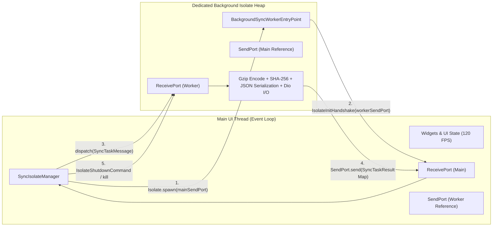
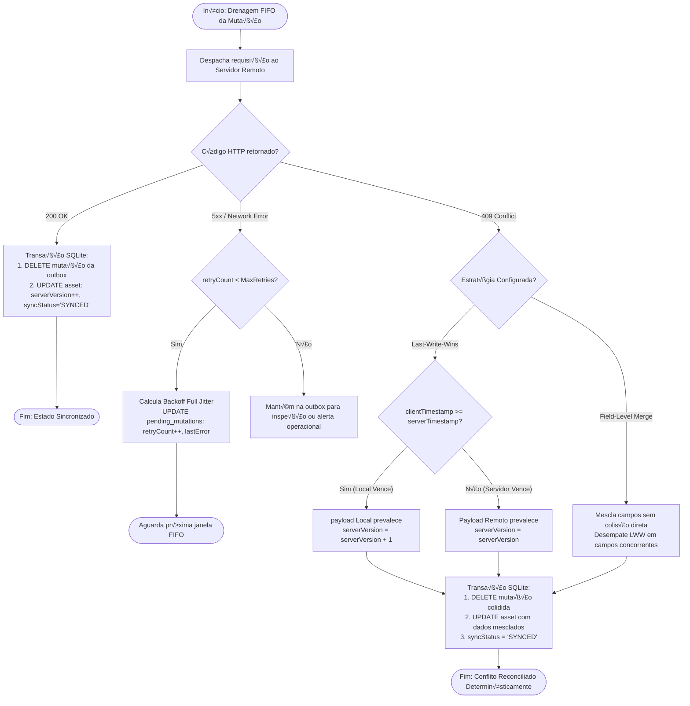

# Arquitetura de Software — Projeto B (Offline-First Asset Engine)

Documento baseado no padr√£o **Arc42** e alinhado com as diretrizes de qualidade de software **ISO/IEC 25010**.

---

## 1. Vis√£o Geral e Requisitos de Qualidade (ISO/IEC 25010)

 1. **Confiabilidade (Reliability - Fault Tolerance & Recoverability)**: Tolerância estrita a quedas abruptas de rede **Flapping Networks**), preservando atomicamente toda intenção de escrita na tabela `PendingMutations` via SQLite ACID.
 2. **Eficiência de Desempenho (Performance Efficiency - Time Behaviour)**: Carga nula de I/O e criptografia na Main UI Thread, preservando a taxa de 120 FPS via Dart Isolates.
 3. **Segurança e Integridade (Security & Data Integrity)**: Garantia de idempotência com identificadores universais UUIDv4 e integridade de payload com hash SHA-256 e compressão Gzip.
 4. **Manutenibilidade (Maintainability - Modularity & Testability)**: Estrutura desacoplada em camadas limpas com separação estrita de contratos.

---

## 2. C4 Model — Nível 3: Diagrama de Componentes

```mermaid
C4Component
    title Component Diagram (C4 Level 3) — Core Architecture

    Container_Boundary(app_boundary, "Offline-First Engine Core")
        Component(view, "AssetListScreen / Form", "Flutter Widgets", "Interface visual com badges de status de sincronização.")
        Component(controller, "AssetController", "ChangeNotifier / State", "Orquestra estado reativo da tela e aciona facades.")
        Component(facade, "LocalRepositoryFacade", "Data Facade", "Garante atomicidade entre atualização do Asset e gravação na Outbox.")
        Component(drift_db, "AppDatabase", "Drift SQLite", "Persistência relacional local com íũdices B-Tree.")
        Component(sync_engine, "SyncEngine", "Core Orchestrator", "Consome outbox FIFO e invoca resolvers de conflito.")
        Component(conflict_res, "ConflictResolver", "LWW / Field-Level", "Aplica fus√£o sem√¢ntica ou Last-Write-Wins em HTTP 409.")
        Component(isolate_mgr, "SyncIsolateManager", "Concurrency Layer", "Gerencia ciclo de vida do worker Isolate via Portas.")
        Component(dio_client, "Dio Client", "HTTP / Interceptors", "Pipeline HTTP com Backoff, Full Jitter e Chaos Interceptors.")
    Container_Boundary_End()

    Rel(view, controller, "Observa e despacha eventos", "Flutter Bindings")
    Rel(controller, facade, "Invoca muta√ß¿Ìes", "Dart async")
    Rel(facade, drift_db, "Transação atômica (Asset + Outbox)", "db.transaction")
    Rel(sync_engine, drift_db, "Drena FIFO e atualiza status", "SQL queries")
    Rel(sync_engine, conflict_res, "Resolve colisões de versão", "In-Memory Algorithm")
    Rel(sync_engine, isolate_mgr, "Despacha tarefas de rede", "Isolate Port")
    Rel(isolate_mgr, dio_client, "Executa requests via worker", "HTTP/2")
```

---

## 3. Modelo de Memória e Concorrência de Dart Isolates

Diferente de threads tradicionais com memória compartilhada, Dart Isolates operam sobre heaps isolados de memória sem locks (*Share-nothing memory architecture*), comunicando-se exclusivamente por cópia de dados primitivos via portas de mensagens.



---

## 4. Diagrama de Sequência de Sincronização & Reconciliação (HTTP 409 Conflict)


---

## 5. Modelo Entidade-Relacionamento do Drift SQLite (ERD)

```mermaid
erDiagram
    ASSETS {
        text id PK "UUIDv4 chave prim√°ria"
        text assetTag UK "Código patrimonial único"
        text name "Descrição do ativo"
        text status "OPERATIONAL | MAINTENANCE | DECOMMISSIONED"
        integer serverVersion "Versão lógica do servidor"
        datetime localUpdatedAt "Timestamp UTC da alteração local"
        text syncStatus "SYNCED | DIRTY | CONFLICT [Indexado]"
    }

    PENDING_MUTATIONS {
        text id PK "UUIDv4 chave primária da mutação"
        text aggregateId "Referência ao ID do ativo"
        text aggregateType "Entidade afetada (ASSET)"
        text action "CREATE | UPDATE | DELETE"
        text payload "Delta serializado em formato JSON"
        integer baseVersion "Versão em que a alteração foi baseada"
        datetime clientTimestamp "Timestamp UTC do dispositivo [Indexado]"
        integer retryCount "Contador incremental de retentativas [Indexado]"
        text lastError "Mensagem ou stack da √∫ltima falha de rede"
        datetime createdAt "Timestamp UTC da criação do registro"
    }

    ASSETS ||--oy PENDING_MUTATIONS : "gera muta√ß¿Ìes na outbox"
```

---

## 6. Fluxograma de Decisão do Motor de Reconciliação



---

## 7. Registros de Decis√£o de Arquitetura (ADRs)

### ADR-001: Adoção do SQLite via Drift com Padrão Outbox Transacional
* **Contexto**: O aplicativo necessita de persistência relacional local, com capacidade reativa e suporte a transações ACID para garantir consistência entre dados de negócios e fila de envio.
* **Decisão**: Utilizar o ORM Drift com SQLite nativo, criando uma tabela de ativos (`Assets`) e uma outbox relacional (`PendingMutations`) vinculadas por transação atômica.
* **Consequ√™ncias**: Elimina estados de inconsist√™ncia onde a UI reflete altera√ß¿Ìes que n√£o foram gravadas na fila de envio ou vice-versa.

### ADR-002: Isolamento Concorrente de I/O e Criptografia com Dart Isolates
* **Contexto**: Serialização JSON volumosa, compressão Gzip e cálculo SHA-256 consomem mais tempo do que a janela de 8.33 ms permitida a 120 FPS.n
* **Decis√£o**: Isolar todo o processamento de background no `BackgroundSyncWorkerIsolate`, mantendo a UI Thread livre de bloqueios.
* **Consequências**: Renderização com latência estável e zero jank garantido sob qualquer carga de lote.

### ADR-003: Reconciliação Híbrida de Conflitos (LWW e Field-Level Merge) em HTTP 409
* **Contexto**: Atualiza√ß¿Ìes concorrentes entre m√∫ltiplos t√©cnicos e o servidor geram diverg√™ncias de vers√£o l√≥gica (*Lost Update Problem*).
* **Decisão**: Implementar `ConflictResolver` extensível, provendo `LastWriteWinsResolver` como padrão temporal e `FieldLevelMergeResolver` para fusão de campos não sobrepostos.
* **Consequências**: Resolução determinística e auditável sem intervenção humana obrigatória em operações rotineiras.

### ADR-004: Mitigação de Thundering Herd via Exponential Backoff com Full Jitter
* **Contexto**: Reabertura de conexões em lote por milhares de dispositivos móveis sobrecarrega os gateways de API centrais.
* **Decisão**: Adotar a fórmula RFC 8900 / AWS Full Jitter no cálculo de intervalos de retry com teto em 60 segundos e máscara de bitwise shift de 30 bits.
* **Consequências**: Distribuição contínua da carga de rede no tempo, estabilizando os servidores em momentos de reinicialização.

### ADR-005: Injeção de Falhas Controlada (Chaos Testing) no Pipeline HTTP do Dio
* **Contexto**: Validar a estabilidade do banco de dados e dos interceptadores sob falhas de conex√£o de borda em ambiente automatizado de CI/CD.
* **Decisão**: Criar o `FaultInjectionInterceptor` com suporte a HTTP 503, quedas de socket, timeouts e corrupção de payload com encadeamento explícito de erros.
* **Connsequências**: Testes automatizados executam cenários de degradação sem depender de infraestrutura física de rede instável.
