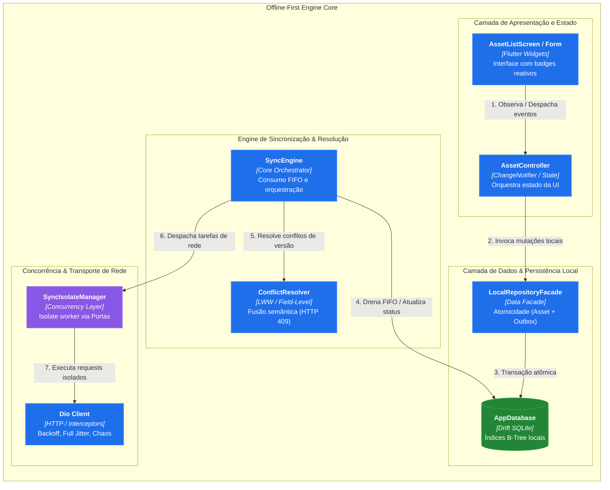
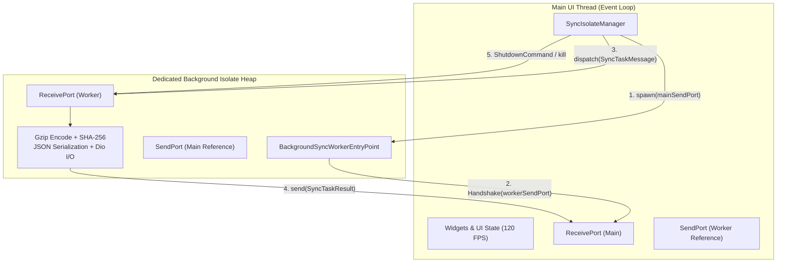
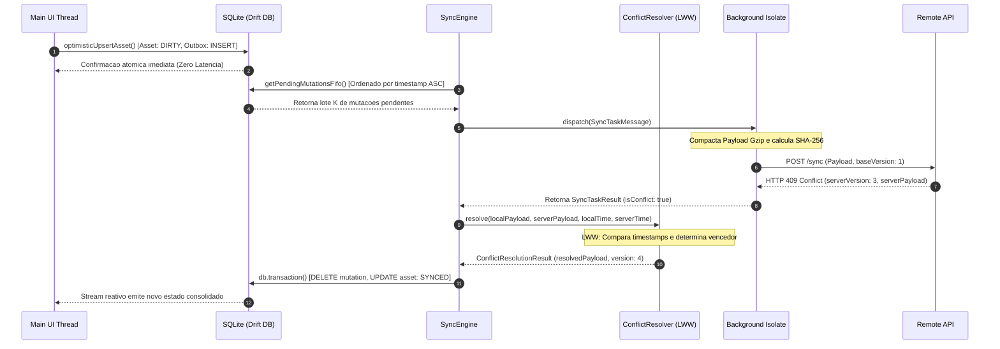
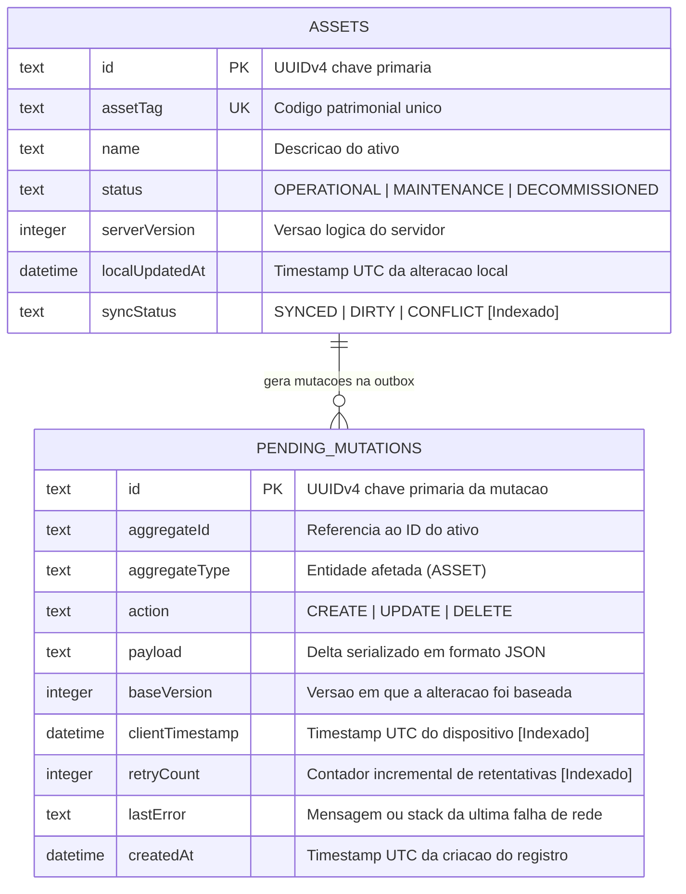

# Arquitetura de Software — Projeto B (Offline-First Asset Engine)

Documento baseado no padrão **Arc42** e alinhado com as diretrizes de qualidade de software **ISO/IEC 25010**.

---

## 1. Visão Geral e Requisitos de Qualidade (ISO/IEC 25010)

1. **Confiabilidade (Reliability - Fault Tolerance & Recoverability)**: Tolerância estrita a quedas abruptas de rede (*Flapping Networks*), preservando atomicamente toda intenção de escrita na tabela `PendingMutations` via SQLite ACID.
2. **Eficiência de Desempenho (Performance Efficiency - Time Behaviour)**: Carga nula de I/O e criptografia na Main UI Thread, preservando a taxa de 120 FPS via Dart Isolates.
3. **Segurança e Integridade (Security & Data Integrity)**: Garantia de idempotência com identificadores universais UUIDv4 e integridade de payload com hash SHA-256 e compressão Gzip.
4. **Manutenibilidade (Maintainability - Modularity & Testability)**: Estrutura desacoplada em camadas limpas com separação estrita de contratos.

---

## 3. Modelo de Memória e Concorrência de Dart Isolates

Diferente de threads tradicionais com memória compartilhada, Dart Isolates operam sobre heaps isolados de memória sem locks (*Share-nothing memory architecture*), comunicando-se exclusivamente por cópia de dados primitivos via portas de mensagens.

---

## 4. Diagrama de Sequência de Sincronização & Reconciliação (HTTP 409 Conflict)

---

## 5. Modelo Entidade-Relacionamento do Drift SQLite (ERD)

---

## 6. Fluxograma de Decisão do Motor de Reconciliação

---

## 7. Registros de Decisão de Arquitetura (ADRs)

### ADR-001: Adoção do SQLite via Drift com Padrão Outbox Transacional

* **Contexto**: O aplicativo necessita de persistência relacional local, com capacidade reativa e suporte a transações ACID para garantir consistência entre dados de negócios e fila de envio.
* **Decisão**: Utilizar o ORM Drift com SQLite nativo, criando uma tabela de ativos (`Assets`) e uma outbox relacional (`PendingMutations`) vinculadas por transação atômica.
* **Consequências**: Elimina estados de inconsistência onde a UI reflete alterações que não foram gravadas na fila de envio ou vice-versa.

### ADR-002: Isolamento Concorrente de I/O e Criptografia com Dart Isolates

* **Contexto**: Serialização JSON volumosa, compressão Gzip e cálculo SHA-256 consomem mais tempo do que a janela de 8.33 ms permitida a 120 FPS.
* **Decisão**: Isolar todo o processamento de background no `BackgroundSyncWorkerIsolate`, mantendo a UI Thread livre de bloqueios.
* **Consequências**: Renderização com latência estável e zero jank garantido sob qualquer carga de lote.

### ADR-003: Reconciliação Híbrida de Conflitos (LWW e Field-Level Merge) em HTTP 409

* **Contexto**: Atualizações concorrentes entre múltiplos técnicos e o servidor geram divergências de versão lógica (*Lost Update Problem*).
* **Decisão**: Implementar `ConflictResolver` extensível, provendo `LastWriteWinsResolver` como padrão temporal e `FieldLevelMergeResolver` para fusão de campos não sobrepostos.
* **Consequências**: Resolução determinística e auditável sem intervenção humana obrigatória em operações rotineiras.

### ADR-004: Mitigação de Thundering Herd via Exponential Backoff com Full Jitter

* **Contexto**: Reabertura de conexões em lote por milhares de dispositivos móveis sobrecarrega os gateways de API centrais.
* **Decisão**: Adotar a fórmula RFC 8900 / AWS Full Jitter no cálculo de intervalos de retry com teto em 60 segundos e máscara de bitwise shift de 30 bits.
* **Consequências**: Distribuição contínua da carga de rede no tempo, estabilizando os servidores em momentos de reinicialização.

### ADR-005: Injeção de Falhas Controlada (Chaos Testing) no Pipeline HTTP do Dio

* **Contexto**: Validar a estabilidade do banco de dados e dos interceptadores sob falhas de conexão de borda em ambiente automatizado de CI/CD.
* **Decisão**: Criar o `FaultInjectionInterceptor` com suporte a HTTP 503, quedas de socket, timeouts e corrupção de payload com encadeamento explícito de erros.
* **Consequências**: Testes automatizados executam cenários de degradação sem depender de infraestrutura física de rede instável.
